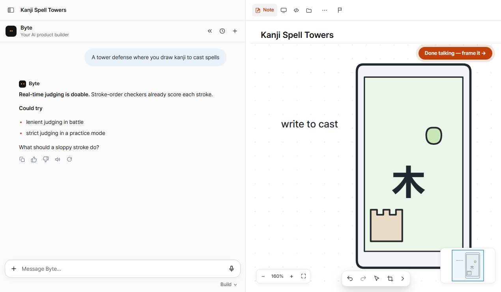
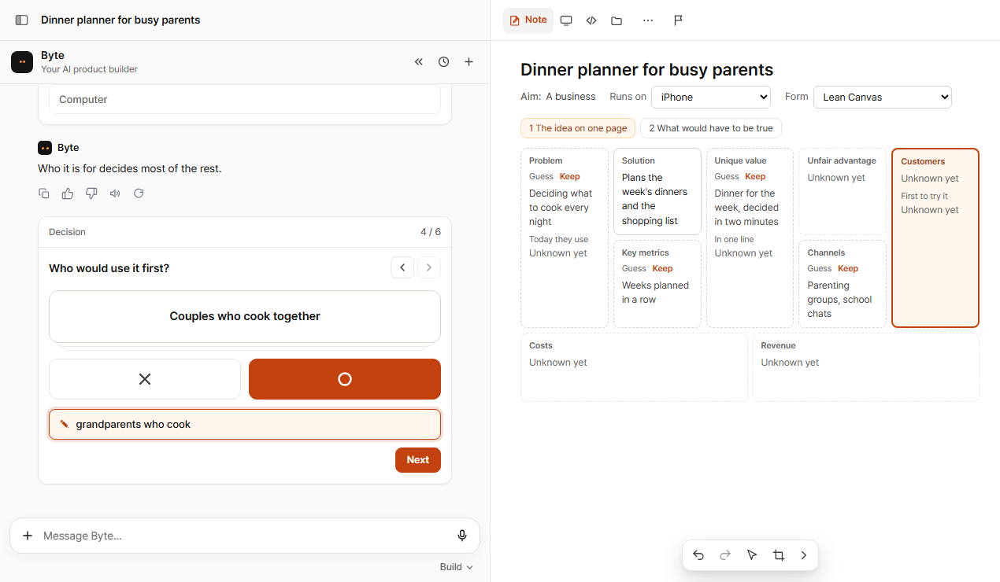
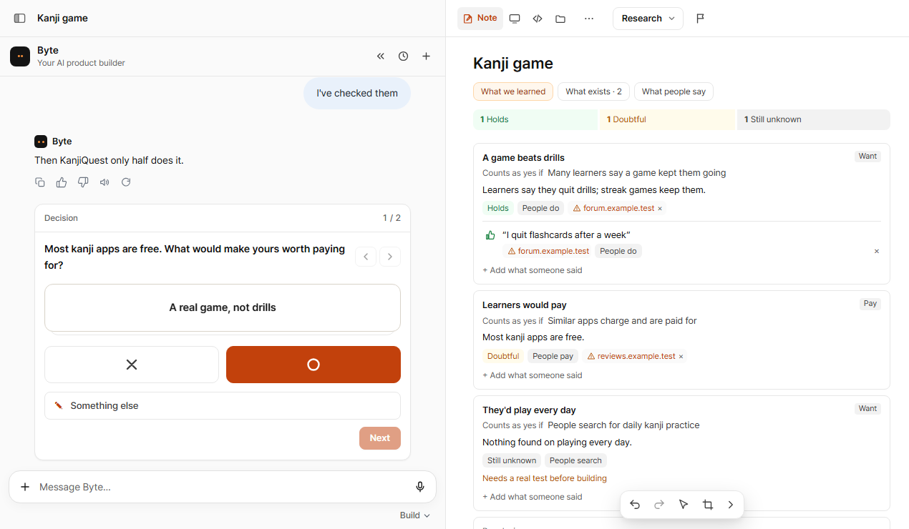
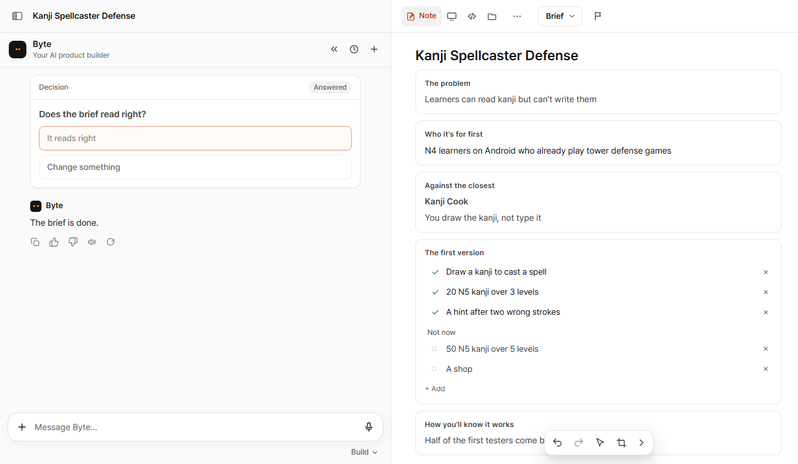
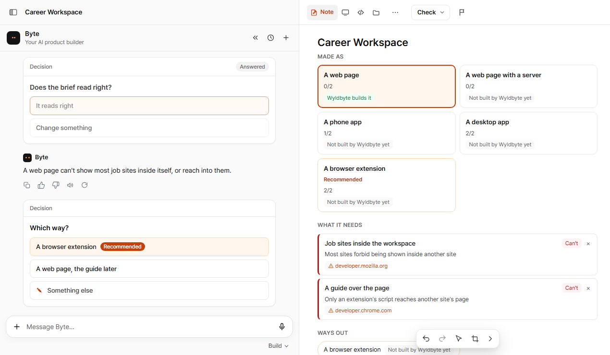
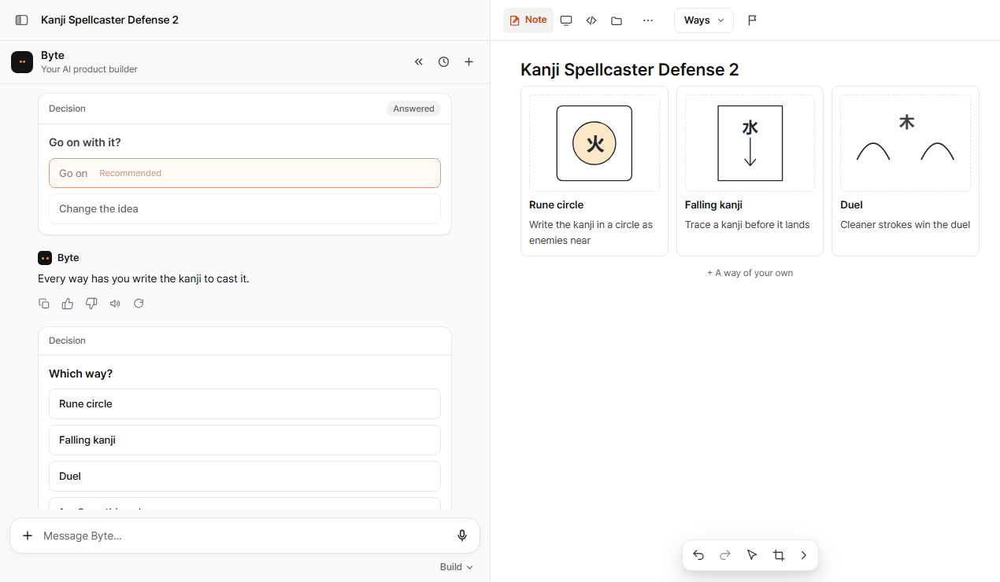
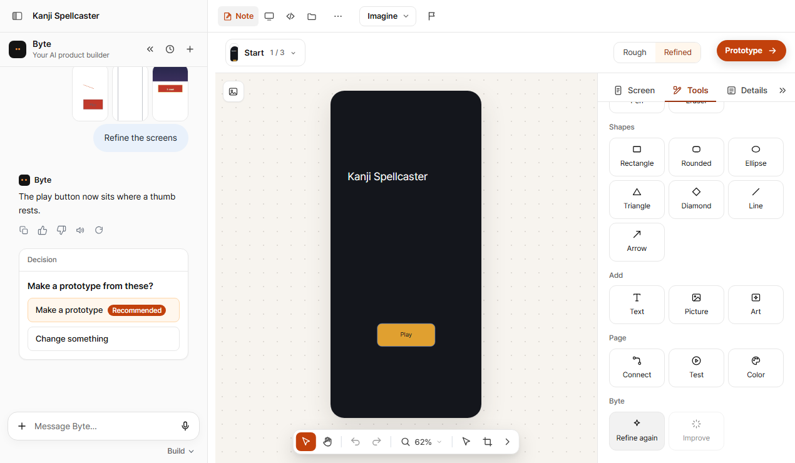
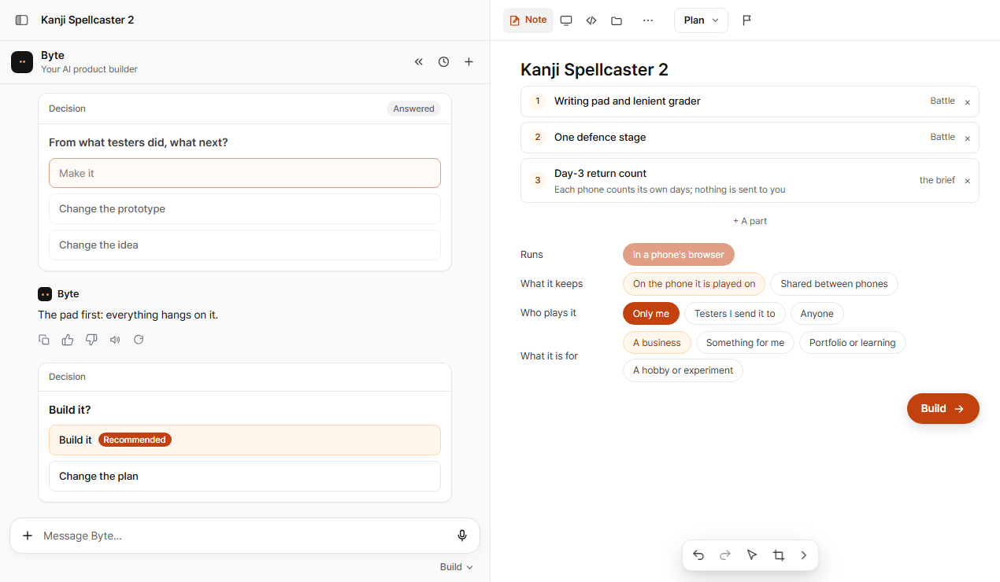

# Wyldbyte

**아이디어에서 소프트웨어를 만드는 AI 환경: Byte와 이야기하면 아이디어가 조사, 기획서, 스케치, 프로토타입을 거쳐 실제로 만들어지고 검증된 제품이 됩니다.**

[English](README.md) · [제품 결정](docs/product.ko.md) · [만든 방법](docs/how-it-was-built.ko.md) · [구조](docs/architecture.ko.md)

> 소스 코드는 비공개입니다.

---

## 하는 일

Wyldbyte는 만들고 싶은 소프트웨어 아이디어는 있지만 개발자는 아닌 사람을 위한 데스크톱 앱입니다. 코드 편집기는 보이지 않습니다. 대신 **Byte**와 이야기합니다. Byte는 좋은 제품 팀이 던질 질문을 하고, 조사를 하고, 문서를 쓰고, 개발은 화면 아래에서 진행합니다. 흐름은 실제로 제품이 만들어지는 순서를 따릅니다: **발견 → 상상 → 계획 → 만들기 → 확인 → 성장**.

| | |
|---|---|
| **대화** | 아이디어는 자유로운 대화로 시작합니다. 이야기하는 동안 Byte는 채팅 옆 캔버스에 아이디어 그림 한 장을 그려 두고, 아이디어가 바뀌면 부분을 더하거나 지웁니다. 무엇이 어렵고, 무엇이 이미 되는 일이고, 무엇을 시도해 볼 만한지 분명히 말합니다. |
| **정리** | 대화를 한 페이지짜리 아이디어(예: 린 캔버스)로 옮기고, 빠진 부분을 한 번에 하나씩 묻습니다. 답이 여러 개일 수 있는 질문은 선택지를 하나씩 보여 주고 O 또는 X로 고르게 합니다. 사용자가 말한 것, Byte가 추측한 것, 조사로 뒷받침된 것은 따로 표시합니다. |
| **조사** | 아이디어가 기대고 있는 믿음을 출처와 함께 확인하고, 이미 있는 제품을 찾습니다: 가장 비슷한 제품과 가장 많이 쓰이는 제품을 Google Play와 App Store에 직접 물어봅니다. 제품마다 스토어 숫자, 화면, 리뷰 요약이 붙습니다. 제품 페이지를 대화 옆에 열어 직접 써 보고 예 / 일부 / 아니요로 표시할 수 있습니다. |
| **기획서** | 한 페이지 기획서: 문제, 처음 쓸 사람, 가장 가까운 경쟁 제품보다 나은 점, 첫 버전(기능마다 넣을지 뺄지는 사용자가 직접 정함), 잘 되는지 알 수 있는 기준. |
| **가능성 확인** | 설계에 들어가기 전에, 제품에 필요한 것마다 웹 페이지, 서버, 휴대폰 앱, 데스크톱 앱, 브라우저 확장 중 무엇으로 가능한지 출처와 함께 확인합니다. Byte는 추천하고, 선택은 사용자가 합니다. Wyldbyte가 아직 만들 수 없는 형태는 그렇다고 말합니다. |
| **방식, 상상, 프로토타입** | 아이디어를 만드는 몇 가지 다른 방식을 나란히 스케치합니다. 고른 방식은 스케치 캔버스에서 화면별로 그리고, 실제 개체로 다듬은 뒤, 직접 해 보고 테스터에게 건넬 수 있는 작은 프로토타입이 됩니다. |
| **계획과 만들기** | 계획은 개발 작업 목록이 아니라 제품으로 사람들이 할 수 있는 일의 지도입니다. Byte의 코딩 작업자가 하나씩, 각자의 테스트와 함께 만들고, 사용자는 기능마다 쉬운 말로 된 확인 방법을 받습니다: "설명을 입력하고 생성을 누르세요. 결과 영역에 이미지가 나타나야 합니다." |

## 화면

모든 화면은 지어낸 데이터로 찍었습니다. AI 대신 정해진 대본을 쓰는 프로젝트 자체의 브라우저 점검이 실제 앱을 실행해 찍은 화면입니다.

| | |
|---|---|
|  |  |
|  |  |
|  |  |
|  |  |

## 제품이 지키는 원칙

- **사용자는 개발이 아니라 제품을 생각합니다.** 코드 편집기도, 터미널도, 포트도 없습니다. 기술 선택은 아래에서 이루어지고, 정말 사용자가 정해야 할 때만 보입니다.
- **말한 것, 추측한 것, 찾은 것을 섞지 않습니다.** Byte의 추측은 사용자가 받아들이기 전까지 추측으로 표시되고, 조사 결과에는 출처가 붙습니다.
- **제품은 데이터를 지어내지 않습니다.** 화면의 모든 숫자는 실제 값이거나, 솔직한 빈 상태이거나, 아직 없는 기능이라고 밝힙니다. 확인되지 않은 사이트 링크는 표시하고 열기 전에 묻습니다.
- **한 번에 한 질문, 결정은 사용자가.** Byte는 추천할 뿐, 제품을 바꾸는 일을 대신 고르지 않습니다.
- **의미는 AI가, 구조는 코드가.** AI 단계가 실패하면 먼저 묻는 것은 프롬프트를 더 세게 쓰는 방법이 아니라, 그 일이 애초에 AI의 몫이어야 하는지입니다.
- **화면에 설명 문구를 두지 않습니다.** 이름표, 동작, 개수, 상태만 보입니다.

자세한 내용은 [docs/product.ko.md](docs/product.ko.md).

## 만든 방법

**Wyldbyte는 Claude Code(Anthropic의 AI 코딩 에이전트)를 주 개발자로 두고 만들었습니다. 코드는 거의 전부 Claude가 썼습니다.**

제가 한 일:
- **제품:** 무엇을, 누구를 위해, 왜 만들지, 그리고 아이디어가 거치는 단계의 순서.
- **기능마다 요구사항과 완료 기준.** 첫 버전을 써 보고 생각을 바꾼 경우가 많습니다.
- **모든 설계와 절충 결정:** AI가 정할 일과 코드가 정해야 할 일, 사용자에게 보여 줄 것, 들여도 되는 비용.
- **모든 변경을 실행 중인 앱에서 직접 테스트**한 뒤에 제가 쓰는 버전에 반영.
- **AI가 쓴 코드를 안전하게 내보내는 개발 흐름**과 그 흐름이 강제하는 규칙.

| | |
|---|---|
| 기간 | 이 저장소 기준 107일 (2026년 7월 28일 – 11월 11일), 진행 중 |
| 커밋 | 2,665개, 그중 2,580개가 Claude와 함께 쓴 것으로 표시됨 |
| 자동 테스트 | 608개 파일의 테스트 함수 7,701개, 실제 앱을 조작하는 브라우저 시나리오 92개 |
| 코드 | Python과 JavaScript 약 25만 9천 줄(테스트, 도구, 외부 라이브러리, 빌드 결과물 제외), 제가 한 줄씩 직접 쓴 코드는 없음 |

AI가 내놓는 대로 받아들이는 의미의 "바이브 코딩"과는 다릅니다. 커밋은 git에서 꺼낸 깨끗한 사본이 실제로 불러와지고 테스트를 통과해야 인정됩니다. 변경은 병합 대기열과 별도의 테스트 앱을 거쳐 들어오고, 제가 쓰는 버전은 제가 확인해야만 바뀝니다. 큰 테스트 실행은 클라우드의 별도 Linux 머신에서 다시 돌려, 결과가 제 노트북에만 기대지 않는지 확인했습니다.

자세한 내용은 [docs/how-it-was-built.ko.md](docs/how-it-was-built.ko.md).

## 사용한 기술

Python · FastAPI · React · Vite · Electron · Playwright · pytest · Claude(Opus, Sonnet)를 Claude Code와 Claude Agent SDK로 제 구독 위에서 사용 · AWS(Linux 검증 머신).

## 상태

개발 진행 중. 아직 내려받을 수 없습니다.

---

© 2026. All rights reserved. 이 저장소의 화면과 글은 허락 없이 다시 쓸 수 없습니다.
