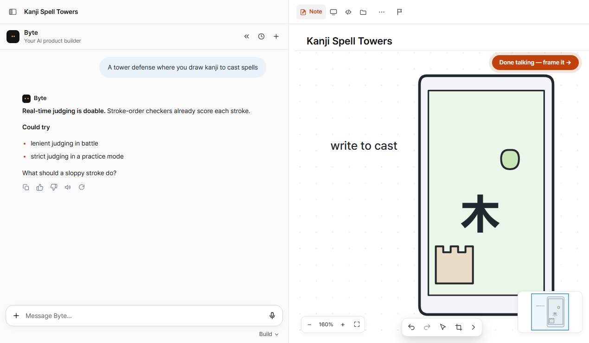
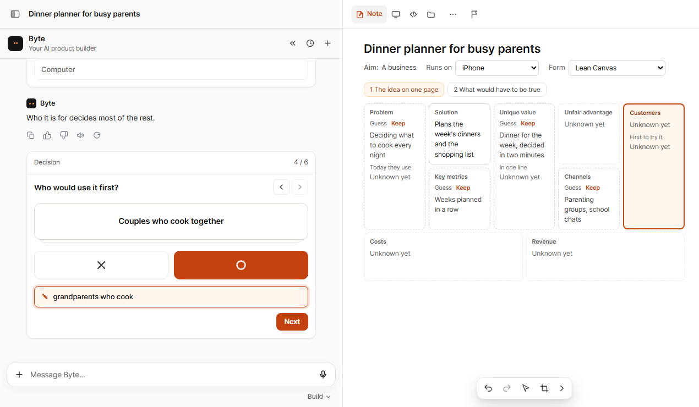
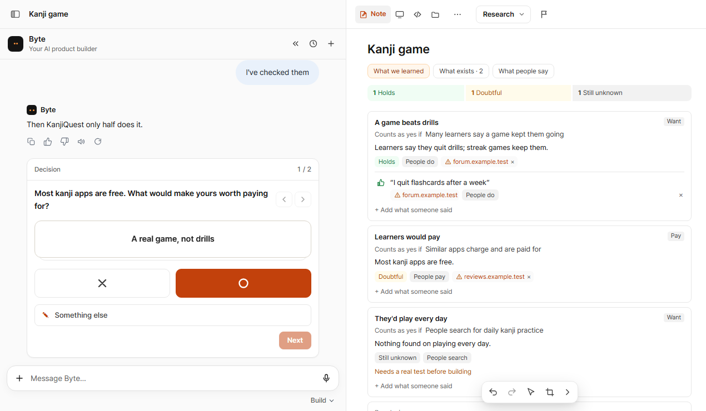
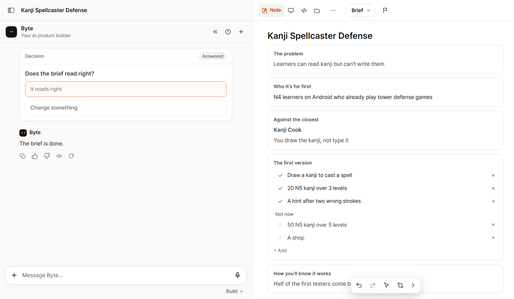
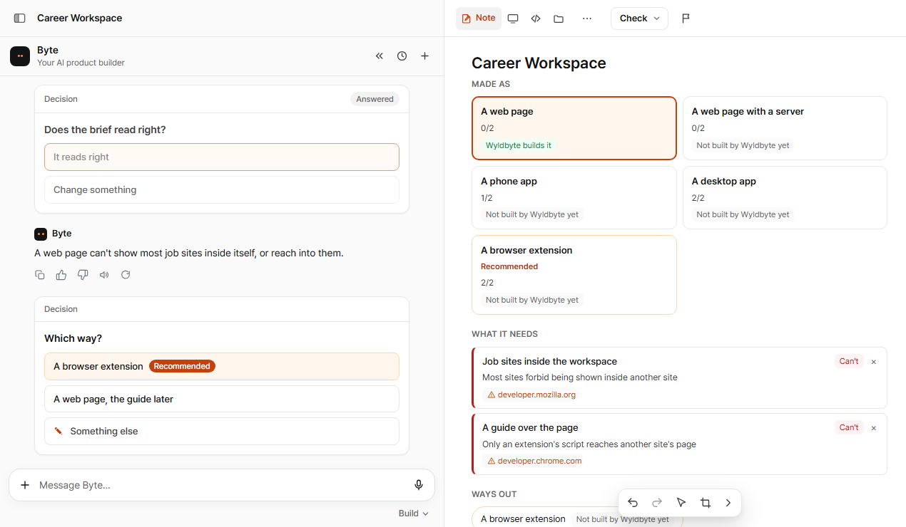
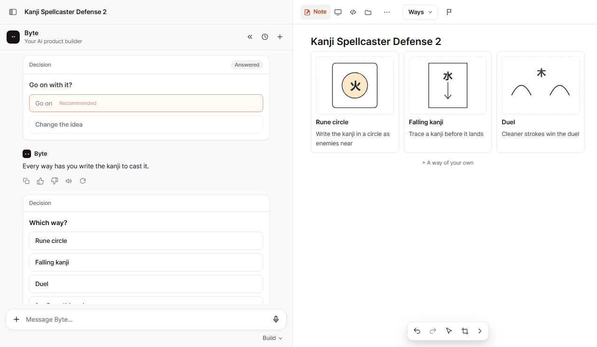
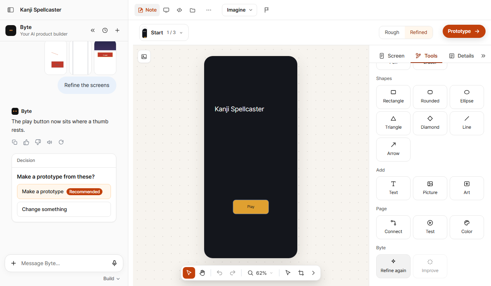
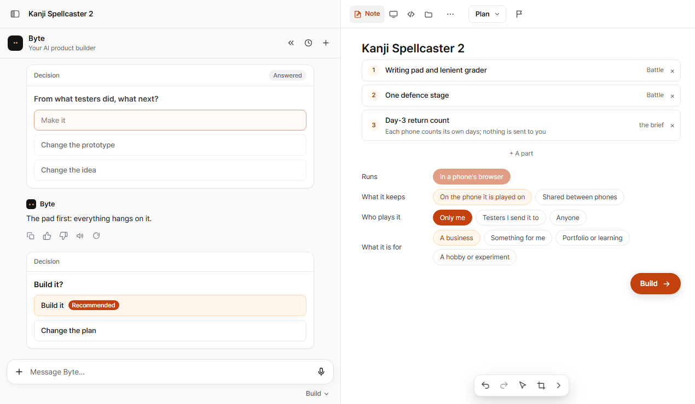

# Wyldbyte

**An AI environment for building software from an idea: you talk to Byte, and it takes the idea through research, a brief, sketches and a prototype to a built, tested product.**

[한국어](README.ko.md) · [Product decisions](docs/product.md) · [How it was built](docs/how-it-was-built.md) · [Architecture](docs/architecture.md)

> The source code is private.

---

## What it does

Wyldbyte is a desktop app for people who have an idea for a piece of software but are not engineers. They don't see an IDE. They talk to **Byte**, a companion that asks the questions a good product team would ask, does the research, writes the documents, and has the engineering done underneath. The journey follows how products are made in real life: **Discover → Imagine → Plan → Build → Accept → Grow**.

| | |
|---|---|
| **Talk** | An idea starts as a free conversation. While it talks, Byte keeps one drawing of the idea on a canvas beside the chat, adding and erasing parts as the idea changes. It says plainly what is hard, what is known to work, and what could be tried. |
| **Frame** | Byte turns the conversation into the idea on one page (for example a Lean Canvas) and asks what is missing, one question at a time. Questions with several answers are gone through one option at a time, O or X. What the person said, what Byte guessed and what research supports are kept apart. |
| **Research** | Byte checks the beliefs the idea depends on, with sources, and finds what already exists: the closest products and the most used ones, asked of Google Play and the App Store directly. Each product shows its store numbers, pictures and what reviewers say. The person can open a product's page beside the conversation, try it, and mark it Yes / Partly / No. |
| **The brief** | A one-page brief: the problem, who it is for first, how it beats the closest competitor, the first version (each feature in or out by the person's own choice) and how they will know it works. |
| **The check** | Before anything is designed, a feasibility check: for each thing the product needs, can it be done as a web page, a server, a phone app, a desktop app or a browser extension, with sources. Byte recommends; the person chooses. What Wyldbyte cannot build yet is said so. |
| **Ways, Imagine, Prototype** | A few different ways to make the idea, sketched side by side. The chosen one is drawn screen by screen on a sketching canvas, refined into real objects, and turned into a small playable prototype the person can try and hand to testers. |
| **Plan and Build** | The plan is a map of what the product lets people do, not engineering tasks. Byte's coding workers build it piece by piece, each piece with its own tests, and the person gets a plain-language test for each: "Enter a description and click Generate. An image should appear in the output area." |

## Screens

All screenshots use made-up data. They were taken by the project's own scripted browser checks, which run the real app with a scripted stand-in for the AI.

| | |
|---|---|
|  |  |
|  |  |
|  |  |
|  |  |

## Principles the product follows

- **The person thinks about the product, not the engineering.** No code editor, no terminal, no ports. Engineering choices are made underneath and shown only when a choice is really the person's.
- **Keep apart what was said, what was guessed and what was found.** Byte's guesses are marked as guesses until the person keeps them; research findings carry their sources.
- **The product never invents data.** Every number on screen is real, an honest empty state, or says plainly that the feature doesn't exist yet. Links to sites Byte hasn't verified are marked and asked about before opening.
- **One question at a time, and the person decides.** Byte recommends; it never chooses for the person on things that change the product.
- **AI decides meaning; code decides structure.** When an AI step fails, the first question is whether that job should belong to AI at all, not how to word the prompt more firmly.
- **No explanatory text in the interface.** Labels, actions, counts and states only.

More in [docs/product.md](docs/product.md).

## How it was built

**I built Wyldbyte with Claude Code (Anthropic's AI coding agent) as the main implementer. Claude wrote almost all of the code.**

My part:
- **The product:** what to build, for whom and why, and the order of the steps an idea goes through.
- **The requirements and acceptance criteria** for every feature, often after trying the first version and changing my mind.
- **Every design and trade-off decision:** what AI may decide and what code must decide, what is shown to the person, what it may cost.
- **Testing every change myself** in the running app before it reached the version I use.
- **The development workflow** that keeps AI-written code safe to ship, and the rules it enforces.

| | |
|---|---|
| Time | 107 days (28 Jul – 11 Nov 2026) in this repository, and continuing |
| Commits | 2,665, of which 2,580 are marked as co-written by Claude |
| Automated tests | 7,701 test functions in 608 files, plus 92 scripted browser journeys that drive the real app |
| Code | about 259,000 lines of Python and JavaScript (tests, tools, vendored libraries and build outputs not counted), none of it written line by line by me |

It isn't "vibe coding" in the sense of accepting whatever the AI produces. A commit counts only once a clean copy of it, taken out of git, imports and passes its tests. Changes reach the app through a merge queue and a separate test app, and the version I use moves only when I confirm. Big runs of the test suite were repeated on a separate Linux machine in the cloud to make sure the results don't depend on my laptop.

The details are in [docs/how-it-was-built.md](docs/how-it-was-built.md).

## Built with

Python · FastAPI · React · Vite · Electron · Playwright · pytest · Claude (Opus and Sonnet) through Claude Code and the Claude Agent SDK, on my own subscription · AWS (a Linux verification machine).

## Status

In active development. Not yet available for download.

---

© 2026. All rights reserved. The screenshots and text in this repository may not be reused without permission.
