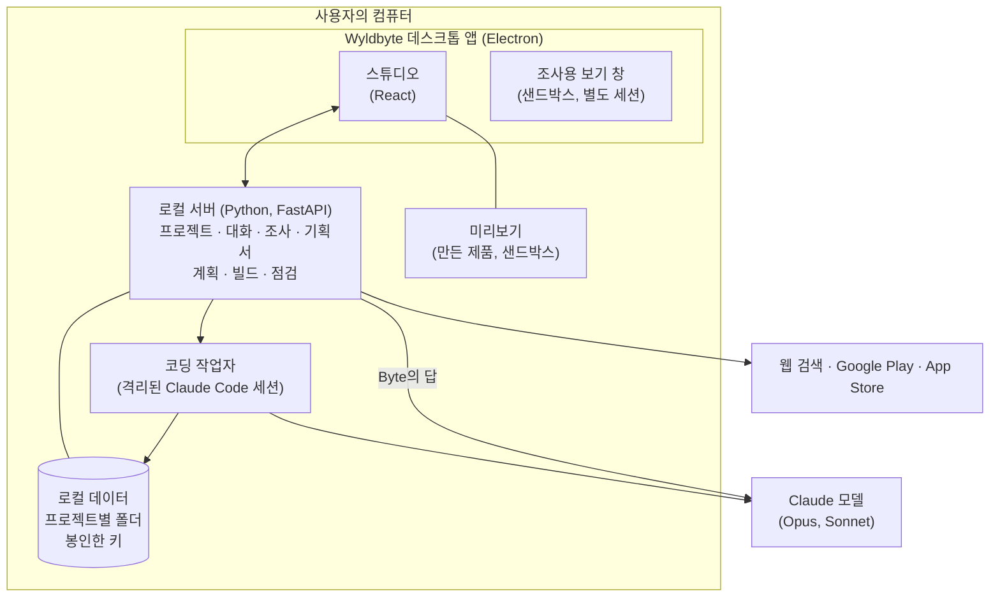
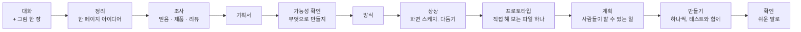

# 구조

[English](architecture.md) · [← README](../README.ko.md)

Wyldbyte가 어떻게 짜여 있는지 한 페이지로 정리했습니다. 코드 없이 시스템의 모양을 알고 싶은 분을 위한 글입니다.

## 구성 요소

- **데스크톱 우선.** 사용자는 서버와 포트가 아니라 "Wyldbyte"를 엽니다. Electron 껍데기가 필요한 로컬 서버를 직접 띄우고 창을 맡으며, 자기가 띄우지 않은 서버는 건드리지 않습니다.
- **로컬 서버 하나**가 프로젝트의 모든 것을 가집니다: 대화, 아이디어의 페이지들(정리, 조사, 기획서, 가능성 확인, 방식, 스케치, 프로토타입), 계획과 빌드. 화면은 일반 HTTP와, Byte가 답하는 동안 흘러오는 이벤트로 이것을 읽습니다.
- **남의 페이지는 격리합니다.** 경쟁 제품의 페이지를 열면 자기 세션을 가진 별도의 샌드박스 보기 창에 열리고, 앱이나 컴퓨터의 파일에는 접근할 수 없습니다. 확인되지 않은 사이트 링크는 표시하고 먼저 묻습니다.

## AI

- **Byte는 개발 도구가 아니라 제품으로서 말합니다.** Byte의 답은 격리된 방식의 Claude Code로 돌아갑니다. 제품 자신의 맥락(아이디어, 조사, 기획서)만 받고, 코딩 도구도 개발자의 설정도 받지 않습니다. 격리할 수 없으면 그 경로로는 말하지 않고, 답할 수 없다고 말합니다.
- **일마다 맞는 모델과 노력.** 아이디어와 조사는 가장 큰 모델로, 작은 일은 중간 모델로 합니다. 조사는 여러 부분으로 나눠 결과를 하나씩 내므로, 도착하는 대로 보입니다.
- **출처는 진짜여야 합니다.** 조사 결과의 출처는 검색이 실제로 돌려준 것만 남깁니다. 경쟁 제품의 숫자(평점, 다운로드)는 스토어에 직접 물어서 가져옵니다. 웹 검색은 인기순으로 정렬하지 않기 때문입니다.
- **의미는 AI가, 구조는 코드가.** 모델은 무엇이 무슨 뜻이고 어디에 쓰이는지를 말합니다. 식별자, 순서, 참조, 형태, 점검은 코드가 하고, 모델이 돌려준 것은 저장하기 전에 모두 검증합니다.
- **모델이 정하지 않는 결정이 있습니다.** Wyldbyte가 어떤 형태의 제품을 만들 수 있는지는 추측하지 않고 만드는 쪽에서 직접 읽어 옵니다. 첫 버전에 어떤 기능을 넣을지는 오직 사용자가 정합니다.

## 아이디어에서 제품까지

- **모든 단계는 대화 옆의 페이지**이고 프로젝트에 남으므로, 조사와 결정이 채팅 기록 속으로 사라지지 않습니다. 대화에서 되돌아가면(메시지를 고치거나 다시 시도하면) 그 뒤에 Byte가 페이지에 쓴 것도 되돌리지만, 사용자가 손으로 바꾼 것은 남깁니다.
- **프로토타입은 웹 페이지 하나**로, 다듬은 화면에서 만들어집니다. 바깥으로 나가는 요청을 모두 막는 샌드박스에서 돌기 때문에 안전하게 써 보고, 파일로 테스터에게 보낼 수 있습니다.
- **계획은 기능의 지도**입니다("주문을 건다", "결과를 본다"). 개발 작업 목록이 아닙니다. 기능마다 격리된 세션의 코딩 작업자가 만들고, 자기 테스트를 갖고, 다음 기능 전에 점검합니다. 비용 한도에 닿은 빌드는 멈추고 그렇다고 말합니다.

## 데이터와 개인정보

- 모든 것은 사용자 컴퓨터의 프로젝트별 폴더에, 대부분 일반 파일(JSON, 그리고 기록을 덮어쓰지 않는 추가 전용 로그)로 저장합니다.
- 외부 서비스의 키는 Windows의 사용자별 암호화로 봉인합니다.
- 비밀 정보는 시스템의 어느 부분도 읽을 수 없는 범주이고, 테스트가 그 선을 지킵니다.
- 지운 프로젝트는 30일 동안 휴지통에 남습니다.

## 품질과 배포

- 단위 테스트는 모든 AI 호출을 대본으로 바꿔 돌립니다: 네트워크 없음, 비용 없음, 늘 같은 결과.
- 브라우저 시나리오는 대본 모델을 쓰는 실제 앱을 실제 브라우저에서 조작합니다.
- 커밋은 git에서 꺼낸 깨끗한 사본이 불러와지고 통과해야 인정됩니다([만든 방법](how-it-was-built.ko.md) 참고).
- 변경은 병합 대기열로 하나씩 들어가, 데이터 사본을 가진 테스트 앱을 거치고, 주인이 확인해야만 메인 앱에 닿습니다.
- 전체 테스트는 클라우드의 별도 Linux 머신에서 다시 돌릴 수 있고, 그 머신은 스스로 꺼지며 월 예산 상한이 있습니다.

개발 흐름은 [how-it-was-built.ko.md](how-it-was-built.ko.md)에 더 자세히 있습니다.
