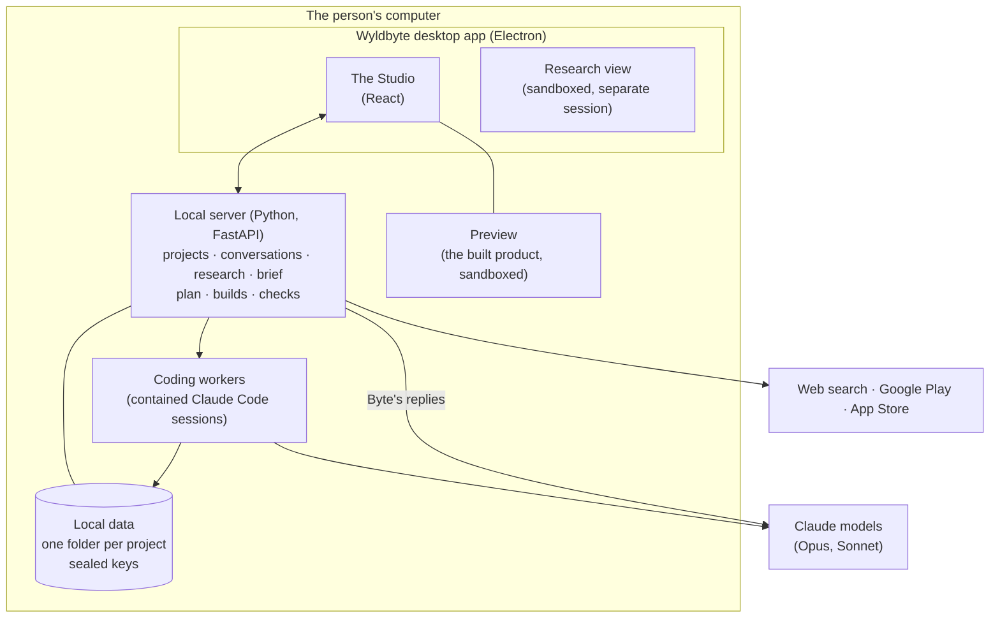

# Architecture

[한국어](architecture.ko.md) · [← README](../README.md)

A one-page overview of how Wyldbyte is put together. It's for readers who want the shape of the system, without the code.

## The pieces

- **Desktop first.** The person opens "Wyldbyte", not a server and a port. The Electron shell starts the local server it needs and owns the window; it never touches a server it didn't start.
- **One local server** holds everything about a project: the conversation, the idea's pages (frame, research, brief, check, ways, sketches, prototype), the plan and the builds. The interface reads it through plain HTTP and a stream of events while Byte replies.
- **Other people's pages stay isolated.** When the person opens a competitor's page, it opens in a separate, sandboxed view with its own session and no access to the app or the computer's files. Links to sites that haven't been checked are marked and asked about first.

## AI

- **Byte talks as the product, never as a developer tool.** Byte's replies run through Claude Code in a contained mode: it receives only the product's own context (the idea, the research, the brief), with no coding tools and no access to the developer's setup. If it can't be contained, it doesn't speak through that route; it says it can't reply.
- **The right model and effort for each job.** Ideas and research run on the largest model, smaller jobs on a mid-size one. Research is done in parts, one finding at a time, so the person sees results as they arrive.
- **Sources must be real.** A research finding keeps a source only if a search actually returned it. Competitor numbers (ratings, downloads) come from asking the stores directly, because web search doesn't rank by popularity.
- **AI decides meaning; code decides structure.** The model says what something means and what it is for. Identities, ordering, references, shapes and checks are done by code, and everything the model returns is validated before it is stored.
- **Some decisions are never the model's.** Whether Wyldbyte can build a given kind of product is read from the builder itself, not guessed. Which features are in the first version is the person's choice alone.

## From idea to product

```mermaid
flowchart LR
    T[Talk<br/>+ one drawing] --> F[Frame<br/>the idea on one page]
    F --> R[Research<br/>beliefs · products · reviews]
    R --> B[The brief]
    B --> C[The check<br/>what it can be made as]
    C --> WY[Ways]
    WY --> I[Imagine<br/>screens sketched, refined]
    I --> PR[Prototype<br/>one playable file]
    PR --> PL[Plan<br/>what it lets people do]
    PL --> BU[Build<br/>piece by piece, tested]
    BU --> AC[Accept<br/>in plain words]
```

- **Every step is a page beside the conversation**, kept in the project, so research and decisions don't disappear into chat history. Going back in the conversation (edit or retry a message) also undoes what Byte wrote on the page since then, but keeps what the person changed by hand.
- **The prototype is a single web page** made from the refined screens. It runs in a sandbox that blocks any outside requests, so it can be tried safely and sent to testers as a file.
- **The plan is a map of capabilities** ("cast a spell", "see the result"), not engineering tasks. Each capability is built by a coding worker in a contained session, gets its own tests, and is checked before the next one starts. A build that hits its cost limit stops and says so.

## Data and privacy

- Everything is stored on the person's computer, one folder per project, mostly as plain files (JSON, and append-only logs so history is never overwritten).
- Keys for outside services are sealed with Windows' own per-user encryption.
- Secrets are a category no part of the system may read: a test holds that line.
- Deleted projects go to a bin for 30 days.

## Quality and releases

- Unit tests run with scripted stand-ins for every AI call: no network, no cost, repeatable.
- Browser journeys drive the real app with a scripted model in a real browser.
- A commit counts only when a clean copy of it, taken out of git, imports and passes (see [how it was built](how-it-was-built.md)).
- Changes land one at a time through a merge queue, go to a test app with a copy of the data, and reach the main app only on the owner's confirmation.
- Full suite runs can be repeated on a separate Linux machine in the cloud, which shuts itself down and has a hard monthly budget.

More on the workflow in [how-it-was-built.md](how-it-was-built.md).
