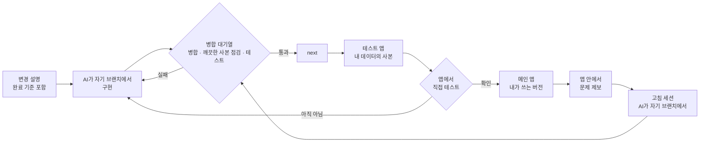

# 만든 방법

[English](how-it-was-built.md) · [← README](../README.ko.md)

Wyldbyte는 한 사람이 AI 코딩 에이전트 Claude Code를 이끌어 만들었습니다. 이 프로젝트에서 가장 신경 써서 설계한 부분이 이 방식이고, 대부분은 실패를 겪으며 배운 것이라 따로 설명합니다.

## 누가 무엇을 했나

| | 나 | Claude Code |
|---|---|---|
| 무엇을 왜 만들지 | ✔ | 선택지를 제안 |
| 요구사항과 완료 기준 | ✔ | 불분명하면 질문 |
| 제품과 설계 결정 | ✔ 결정 | 제안하고 장단점 설명, 시안 제작 |
| 코드 작성 | | ✔ 거의 전부 |
| 자동 테스트와 브라우저 시나리오 | 규칙을 정함: 고침에는 테스트가 함께 | ✔ 작성 |
| 실행 중인 앱에서 테스트 | ✔ 제게 오는 모든 변경 | 자체 실행에서 화면과 영상을 남김 |
| 제가 쓰는 버전 바꾸기 | ✔ 나만 | |
| 아래의 개발 흐름 | ✔ 규칙을 설계 | ✔ 필요한 도구를 만듦 |

코드를 한 줄씩 쓰거나 검토하지는 않았습니다. 제가 설명할 수 있는 것은 시스템이 어떻게 짜여 있고 왜 그렇게 동작하는지입니다: 구조, 데이터 흐름, 규칙, 그리고 그 뒤의 결정들.

## 개발 흐름

### 1. 깨끗한 사본이 동작해야 커밋으로 인정합니다

가장 강하게 지키는 규칙이고, 실제 사고에서 나왔습니다.

어느 날, 제대로 테스트까지 마친 변경이 커밋됐는데, 그 코드가 불러오는 새 파일 두 개는 git에 한 번도 추가되지 않았습니다. 제 컴퓨터에서는 파일이 폴더에 있으니 모든 게 돌아갔습니다. git 안의 코드는 깨져 있었습니다. 11시간 동안, 커밋 18개가 더 쌓일 때까지 아무도 몰랐습니다. 그 구간의 깨끗한 사본으로는 테스트의 약 3분의 1만 돌릴 수 있었습니다. **프로젝트의 모든 점검이 디스크의 폴더를 대상으로 돌았고, 폴더에는 파일이 있었습니다.**

그래서 지금은 두 상태를 구분합니다:

- **커밋됨:** git에 그 커밋이 있음.
- **착지함(landed):** 검증 도구가 바로 그 커밋을 git에서 빈 폴더로 꺼내, 코드가 불러오는 모듈이 전부 커밋 안에 있는지 확인하고, 거기서 테스트를 돌렸음.

"착지함"은 어디에도 저장하지 않습니다. 검증 도구를 실행해서 그때그때 판단하므로 낡을 수 없고, 확인하지 않은 사람이 주장할 수도 없습니다. 이정표는 커밋 ID가 담긴 한 줄로 보고하고, 아직 착지하지 않은 커밋 위에 쌓은 작업은 그렇다고 밝힙니다. 아래의 병합 대기열이 모든 변경에 이 점검을 돌립니다.

### 2. 병합 대기열, 테스트 앱, 메인 앱

여러 AI 세션이 동시에 일하는 경우가 많습니다. 세션마다 자기 저장소 사본에서 자기 브랜치로 작업합니다. 끝난 변경은 병합 대기열을 통해 **한 번에 하나씩** 개발 줄기(`next`)에 들어갑니다:

- 별도 사본에서 변경을 최신 `next`와 병합하고;
- 그 결과에 깨끗한 사본 점검과, 바뀐 파일의 테스트를 돌리고;
- 이미 알려진 실패 목록에 있는 실패는 막지 않지만, 새로운 실패가 나오면 되돌려 보내며;
- 모두 통과해야만 `next`가 앞으로 나아갑니다.

`next`에서 배포 스크립트가 빌드를 **테스트 앱**에 올립니다. 테스트 앱은 제 데이터의 사본을 가진 별도 창입니다. 저는 거기서 변경을 써 봅니다. 제가 확인해야만, 데이터를 백업한 뒤 제가 실제로 쓰는 **메인 앱**이 그 빌드로 바뀝니다.

### 3. 관리 앱에서 제보와 고침 세션

프로젝트에는 저만 쓰는 두 번째 데스크톱 앱, **Wyldbyte Admin**이 있습니다:

- **버전:** 대기열에서 기다리는 것, 테스트에 있는 것, 메인에 있는 것, 그리고 변경마다 무엇을 하고 어떻게 확인하는지 적힌 인계 목록.
- **제보:** 앱 안에서 창 화면과 함께 보낸 문제. AI가 비슷한 제보를 묶고, 버튼 하나로 **고침 세션**을 시작합니다. 자기 브랜치에서 문제를 고친 Claude Code 세션이 같은 대기열과 테스트 앱을 거쳐 돌아옵니다.
- **AI 사용량, 테스트, 디자인**, 그리고 자기 브랜치에서 작은 변경을 해 주는 도우미.

이 구성은 이미 효과가 검증된 제 다른 제품 Career Workspace에서 일부러 그대로 가져왔습니다.

### 4. AI에 기대지 않는 테스트, 무엇이 진짜였는지 밝히는 증거

- **단위 테스트는 실제 모델을 부르지 않습니다.** AI를 부를 부분은 대본으로 바꿔 두므로 비용이 없고 늘 같은 결과가 나옵니다.
- **브라우저 시나리오**는 AI 대신 대본을 쓰는 실제 앱을 띄우고, 실제 브라우저에서 클릭해 나갑니다: Byte와 대화하고, 카드에 답하고, 조사하고, 기획서를 쓰고, 만듭니다. 생김새가 아니라 화면이 하는 일을 점검합니다. 이 저장소의 화면도 여기서 나왔습니다.
- **실제 실행은 측정합니다.** 실제 모델로 기능을 시험하면 시간과 비용을 적어 둡니다(예: 아이디어를 만드는 방식 세 가지에 28초, $0.09; 직접 해 볼 수 있는 프로토타입에 57초, $0.15).
- **증거 영상에는 표시를 붙입니다.** 큰 이정표의 시연 영상은 구간마다 **REAL**(실제 모델을 쓴 실제 앱) 또는 **STAND-IN**(대본을 쓰는 점검 환경)으로 표시하고, 빨리 감은 구간은 실제 걸린 시간을 보여 줍니다.
- **실패 목록은 하나, 이유와 함께.** 알려진 실패는 이유와 함께 한 파일에 둡니다. 테스트 실행은 실패를 이름으로 목록과 비교하므로, 새 실패가 옛 실패에 묻히지 않고 드러납니다.

### 5. 제 노트북이 아닌 두 번째 머신

결과가 제 노트북에만 기대지 않도록, 커밋을 **AWS의 Linux 검증 머신**으로 보내 전체 테스트를 돌릴 수 있습니다:

- 비밀 정보 검사를 거친 뒤, 걸러 낸 커밋 파일만 보냅니다;
- 그 머신은 제 계정에 접근할 수 없고, 실행 중에는 아무것도 내려받지 않습니다;
- 요금이 불어날 수 없게 했습니다: 4시간이 지나면 감시 장치가 전원을 끄고, 유휴 경보와 매일 정해진 시각에 멈추며, 월 $30 예산을 넘으면 자동으로 멈춥니다.

그곳에서 약 17,000개 테스트를 독립적으로 두 번 돌린 결과가 서로 일치했고, 노트북 결과와 다른 부분은 모두 이유가 밝혀졌습니다.

### 6. 아무것도 잃지 않고 새 버전으로 옮기기

중간에 프로젝트 전체를 새 자리로 옮겼습니다(버전 A에서 B로). A는 한 커밋에서 얼려 읽기 전용 표본으로 남겼고, B는 정확한 사본에서 시작해 이유를 밝힌 파일 8개만 바꾸고 전체 기록을 그대로 가져왔습니다. 그 뒤의 비교는 모두 살아 있는 옛 버전이 아니라 얼린 사본을 대상으로 합니다. 나중에 개발 자리를 느린 USB 디스크에서 노트북 자체 드라이브로 옮길 때도, 되돌리는 계획을 글로 써 두고 같은 방식으로 옮겼습니다.

## 배운 것

- **"내 컴퓨터에서는 된다"가 가장 위험한 통과입니다.** 깨끗한 사본 규칙은 git이 깨져 있는데도 모든 점검이 통과했기 때문에 생겼습니다.
- **좋은 의도보다 안전장치가 낫습니다.** 변경을 거부하는 대기열이 "테스트 꼭 돌려 주세요"보다 강합니다.
- **AI 단계가 계속 실패하면, 그 일을 AI에게서 거둡니다.** 가장 큰 고침 몇 가지는 모델의 책임(이름 붙이기, 단계 순서, 참조 연결)을 덜어 코드에 넘긴 것이었습니다. 실패하던 실행이 오류 없이 변경 55개를 적용하게 됐습니다.
- **증거는 무엇이 진짜였는지 말해야 합니다.** 대본으로 돌린 시연도 쓸모 있지만, 그렇다고 밝힐 때만입니다.
- **하지 않은 일을 분명히 하는 것이 중요합니다.** 저는 시스템과 그 안의 모든 결정을 설명할 수 있습니다. 코드를 썼다고 말할 수는 없습니다.
