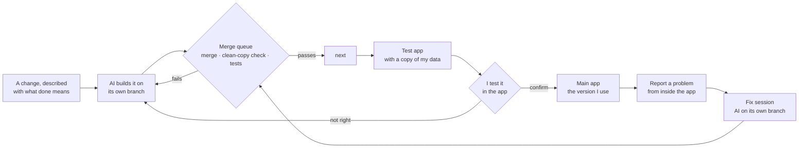

# How it was built

[한국어](how-it-was-built.ko.md) · [← README](../README.md)

Wyldbyte was built by one person directing an AI coding agent, Claude Code. This page explains the setup, because it's the part of the project I designed most deliberately, and most of it was learned the hard way.

## Who did what

| | Me | Claude Code |
|---|---|---|
| What to build and why | ✔ | suggests options |
| Requirements and acceptance criteria | ✔ | asks when something is unclear |
| Product and design decisions | ✔ decides | proposes, explains trade-offs, builds mockups |
| Writing the code | | ✔ almost all of it |
| Automated tests and browser journeys | sets the rule: a fix comes with its tests | ✔ writes them |
| Testing in the running app | ✔ every change that reaches me | takes screenshots and recordings in its own runs |
| Moving the version I use | ✔ only me | |
| The development workflow below | ✔ designed the rules | ✔ built the tools for them |

I didn't write or review the code line by line. What I can explain is how the system is put together and why it behaves as it does: the architecture, the data flows, the rules and the decisions behind them.

## The workflow

### 1. A commit counts only when a clean copy of it works

This is the rule with the most teeth, and it came from a real failure.

One day a real, tested change was committed whose code imported two new files that had never been added to git. On my computer everything ran, because the files were there. In git, the code was broken. Nobody noticed for 11 hours and 18 more commits. A clean copy of that stretch could run only about a third of the tests. **Every check the project had was run against the folder on disk, and the folder had the files.**

So the project now separates two states:

- **Committed:** git has the commit.
- **Landed:** a verifier took that exact commit out of git into an empty folder, checked that every module it imports is really in the commit, and ran the tests there.

Nothing stores "landed"; it is worked out by running the verifier, so it can't go stale and nobody can claim it without checking. A milestone is reported as one line with the commit IDs, and work built on a commit that hasn't landed is called out. The merge queue below runs the check on every change.

### 2. A merge queue, a test app and a main app

Several AI sessions often work at once. Each works on its own branch in its own copy of the repository. Finished changes join the main development line (`next`) **one at a time** through a merge queue:

- the change is merged with the latest `next` in a separate copy;
- the clean-copy check and the tests for the changed files run on the result;
- a failure that is already on the project's list of known failures doesn't block it; a new one sends it back;
- only if everything passes does `next` move forward.

From `next`, a release script puts the build into a **test app**: a separate window with its own copy of my data. I try the change there. Only when I confirm does the **main app**, the one I actually use, move to that build, after a backup of its data.

### 3. Reports and fix sessions from an admin app

The project has a second desktop app just for me, **Wyldbyte Admin**:

- **Versions:** what's waiting in the queue, what's in test and what's in main, with a handover list of what each change does and how to check it.
- **Reports:** problems sent from inside the app with a screenshot of the window. AI groups similar reports, and one button starts a **fix session**: a Claude Code session on its own branch that fixes it and comes back through the same queue and test app.
- **AI usage, tests and design**, and an assistant that can make small changes on its own branch.

This setup was copied on purpose from my other product, Career Workspace, where it had already proven itself.

### 4. Tests that don't depend on the AI, and evidence that says what was real

- **Unit tests never call a real model.** The parts that would call AI are replaced by scripts, so the tests are free and repeatable.
- **Browser journeys** start the real app with a scripted stand-in for the AI, then click through it in a real browser: talk to Byte, answer a card, research, write the brief, build. They check what the page does, not how it looks. The screenshots in this repository come from them.
- **Real runs are measured.** When a feature is tried with the real model, the time and cost are written down (for example: three ways to make an idea in 28 seconds for $0.09; a playable prototype in 57 seconds for $0.15).
- **Evidence videos are labelled.** For bigger milestones, the walkthrough video marks every segment as **REAL** (the real app with the real model) or **STAND-IN** (the scripted harness), and every sped-up stretch shows its real time.
- **One list of what is red, and why.** Known failures are kept in one file with a reason each. A test run compares its failures to the list by name, so a new failure stands out instead of drowning among old ones.

### 5. A second machine that isn't my laptop

To make sure results don't depend on my laptop, the project can send a commit to a **Linux verification machine on AWS** and run the whole suite there:

- only the commit's files are sent, filtered, after a scan for secrets;
- the machine has no access to my accounts and nothing it needs is downloaded during a run;
- it can't run up a bill: a watchdog powers it off after 4 hours, an idle alarm and a daily schedule stop it, and a monthly budget of $30 stops it automatically.

Two independent runs of about 17,000 tests there agreed with each other, and every difference from the laptop's results was explained.

### 6. Moving to a new version of the project without losing anything

Midway, the whole project was moved to a new home (version A to version B). A was frozen at one commit and kept as a read-only specimen; B started as an exact copy with only eight files changed, each for a stated reason, and its full history. Every comparison since runs against the frozen copy, never against the live old one. Later, active development moved from a slow USB disk to the laptop's own drive in the same careful way, with a written rollback plan.

## What I learned

- **"It works on my machine" is the most dangerous kind of passing test.** The clean-copy rule exists because every check passed while git was broken.
- **Guardrails beat good intentions.** A queue that refuses a change is stronger than "please run the tests".
- **When an AI step keeps failing, take the job away from the AI.** Several of the biggest fixes were removing responsibilities from the model (naming things, ordering steps, linking references) and giving them to code. One run went from failing to applying 55 changes with no errors.
- **Evidence has to say what was real.** A demo with a scripted model is useful, but only if it says so.
- **Being clear about what I didn't do matters.** I can explain the system and every decision in it. I can't claim to have written the code.
